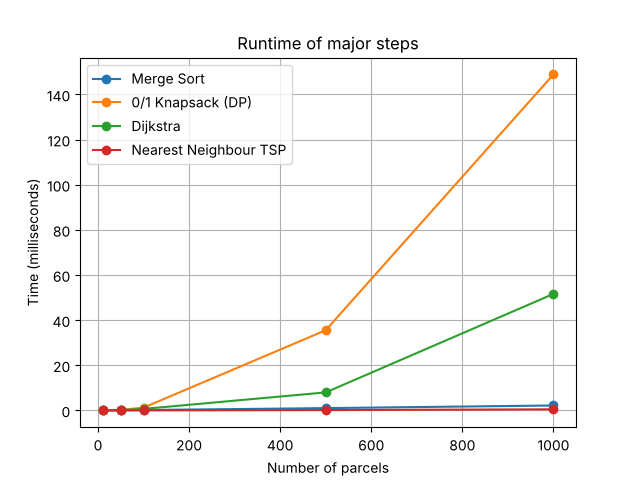

# Capstone Assignment – Mini-Courier Planner (Sem-3)

Rahul (2501350043) - DAA

Course: Design & Analysis of Algorithms (ETCCDA302)
Faculty: Dr. Shweta Agarwal

## About

This is my capstone project for DAA. It is a small courier planner made in Python.
We give it a list of parcels and a road map, and it tells two things -

- which parcels should be loaded in the van for one trip (packing plan)
- in which order the van should go to the delivery points (delivery route)

I have used the algorithms from the lab assessments - Merge Sort, 0/1 Knapsack (DP),
Dijkstra and Nearest Neighbour (approximation for TSP).

No library is used for the algorithms, only Python built-in modules.
matplotlib is used only to make the runtime chart.

## Project Structure

```
main.py              -> main file, runs all the steps
sorting.py           -> merge sort
knapsack.py          -> 0/1 knapsack using DP
route.py             -> graph, dijkstra and nearest neighbour route
generate_data.py     -> makes random data for bigger tests
test_cases.py        -> test cases
performance_test.py  -> runtime test + chart
data/                -> csv files (sample data)
results/             -> runtime chart
screenshots/         -> output screenshots
```

## How to Run

Install matplotlib first (only needed for the chart)

```
pip install matplotlib
```

Run with the small sample data (van capacity is 20 kg)

```
python main.py
```

For any other data give the parcels file, roads file and van capacity

```
python main.py data/parcels_medium.csv data/roads_medium.csv 60
```

Test cases

```
python test_cases.py
```

Performance test (chart gets saved in the results folder)

```
python performance_test.py
```

`python generate_data.py` makes a new random medium dataset.

## Phase 1 - Courier Problem Design and Planning

### Problem

There are many parcels in the depot but the van can carry only limited weight in one trip.
So first we have to see which parcels are urgent, then select the best parcels which can fit
in the van, and then find a short route to deliver them and come back to the depot.

### Parcel details

| Field | Meaning | Example |
|---|---|---|
| parcel_id | parcel number | P1 |
| destination | delivery point | C |
| weight | weight in kg | 6 |
| priority | 1 to 10 (10 = most important) | 8 |
| deadline | has to be delivered within these many hours | 2 |

Parcels file (data/parcels_small.csv) -

```
parcel_id,destination,weight,priority,deadline
P1,C,6,8,2
P2,A,3,5,4
P3,E,9,9,3
...
```

### Delivery points and graph

The van always starts from `Depot`. In the small data the delivery points are A to F,
and in the random data they are C1, C2 and so on.

Roads are given in a csv file as `from,to,distance` (distance in km). All roads are two way
so the map is an undirected weighted graph.

I have stored the graph as an adjacency list (dictionary). Every place has only a few roads,
so it takes less memory than a matrix and in dijkstra we can directly loop over the neighbours.

```
graph["A"] = [("Depot", 4), ("B", 1), ("C", 5)]
```

Roads file (data/roads_small.csv) -

```
from,to,distance
Depot,A,4
Depot,B,2
A,B,1
A,C,5
B,C,8
B,D,10
C,D,3
C,E,2
D,E,4
D,F,6
E,F,3
```

### Algorithms used

| Step | Algorithm | Time | Space |
|---|---|---|---|
| Sort the parcels | Merge Sort | O(n log n) | O(n) |
| Select parcels for the van | 0/1 Knapsack (DP) | O(n x W) | O(n x W) |
| Shortest paths | Dijkstra | O(V^2) for one source | O(V) |
| Delivery route | Nearest Neighbour | O(k^2) | O(k) |

n = no. of parcels, W = van capacity, V = no. of places, k = no. of stops

Why I used these -

- Merge sort is O(n log n) in every case (quick sort can go to O(n^2) in worst case).
  It is also stable, so if two parcels have same deadline and priority, their order does not change.
- In 0/1 knapsack a parcel can't be broken, we take it fully or leave it. Greedy does not
  always give the best answer here (example is in phase 2), DP gives the best answer.
- Road distances are never negative and we need the shortest distance from one place to all
  other places, so dijkstra is fine for this.
- Finding the exact best route (TSP) is NP-hard, for k stops there are k! orders to check.
  Nearest neighbour gives a good route very fast, that's why I used it.

Dijkstra runs from the Depot and from every stop, so the full dijkstra part is O(k x V^2).

### Design

```
parcels.csv                          roads.csv
     |                                   |
     v                                   v
Merge Sort                          make graph
(deadline, then priority)           (adjacency list)
     |                                   |
     v                                   |
0/1 Knapsack DP --> packing plan         |
     |                                   |
     | delivery points of                |
     | selected parcels                  v
     +------------------------> Dijkstra (from Depot and every stop)
                                         |
                                         v
                                Nearest Neighbour route
                                         |
                                         v
                                final route + total km
```

Sorting is done before knapsack so that the packing plan comes in deadline order. Also if two
groups of parcels give the same total priority, the DP keeps the parcels with earlier deadline,
because while going back in the table it leaves out the later parcels first.

## Phase 2 - Package Prioritization and Box Filling

Output of `python main.py` -

```
============================================================
                  MINI-COURIER PLANNER
============================================================
Parcels file    : parcels_small.csv
Roads file      : roads_small.csv
Van capacity    : 20 kg
Total parcels   : 10
Delivery points : 6 (+ Depot)
Roads           : 11

------------------------------------------------------------
STEP 1 : Parcels sorted by deadline, then priority (Merge Sort)
------------------------------------------------------------
ID    Dest    Weight  Priority  Deadline
P5    F       5       7         1
P1    C       6       8         2
P7    A       4       6         2
P3    E       9       9         3
P2    A       3       5         4
P10   B       5       5         4
P6    D       8       6         5
P4    B       2       3         6
P9    C       1       2         7
P8    E       7       4         8

------------------------------------------------------------
STEP 2 : Box filling using 0/1 Knapsack (Dynamic Programming)
------------------------------------------------------------
DP table (w = weight, p = priority) :
capacity ->        0  1  2  3  4  5  6  7  8  9 10 11 12 13 14 15 16 17 18 19 20
no parcel          0  0  0  0  0  0  0  0  0  0  0  0  0  0  0  0  0  0  0  0  0
P5 (w=5,p=7)       0  0  0  0  0  7  7  7  7  7  7  7  7  7  7  7  7  7  7  7  7
P1 (w=6,p=8)       0  0  0  0  0  7  8  8  8  8  8 15 15 15 15 15 15 15 15 15 15
P7 (w=4,p=6)       0  0  0  0  6  7  8  8  8 13 14 15 15 15 15 21 21 21 21 21 21
P3 (w=9,p=9)       0  0  0  0  6  7  8  8  8 13 14 15 15 15 16 21 21 21 22 23 24
P2 (w=3,p=5)       0  0  0  5  6  7  8 11 12 13 14 15 18 19 20 21 21 21 26 26 26
P10 (w=5,p=5)      0  0  0  5  6  7  8 11 12 13 14 15 18 19 20 21 21 23 26 26 26
P6 (w=8,p=6)       0  0  0  5  6  7  8 11 12 13 14 15 18 19 20 21 21 23 26 26 26
P4 (w=2,p=3)       0  0  3  5  6  8  9 11 12 14 15 16 18 19 21 22 23 24 26 26 29
P9 (w=1,p=2)       0  2  3  5  7  8 10 11 13 14 16 17 18 20 21 23 24 25 26 28 29
P8 (w=7,p=4)       0  2  3  5  7  8 10 11 13 14 16 17 18 20 21 23 24 25 26 28 29

Packing plan for this trip :
ID    Dest    Weight  Priority  Deadline
P5    F       5       7         1
P1    C       6       8         2
P7    A       4       6         2
P2    A       3       5         4
P4    B       2       3         6

Parcels selected   : 5 out of 10
Total weight       : 20 / 20 kg
Total priority     : 29
Left for next trip : P3, P10, P6, P9, P8
```

- P5 has the earliest deadline (1 hour) so it comes first. P1 and P7 both have deadline 2,
  P1 comes first because its priority is more (8 > 6). P2 and P10 have same deadline and same
  priority so they stay in the same order as in the file (merge sort is stable).
- In the DP table, row P7 and column 15 is 21. It means if we use only the first three parcels
  (P5, P1, P7) and have 15 kg space, the best total priority is 21 (7 + 8 + 6).
  The last cell (29) is the final answer.
- So the van takes P5, P1, P7, P2 and P4. Total weight is 20 kg (van is full) and total priority is 29.
- If we do it greedy (take highest priority first) we get P3, P1, P5 = only 24. P3 has priority 9
  but it is 9 kg, and the best we can get with P3 is 26. So greedy fails here and DP is needed.

## Phase 3 - Route Maker and Graph Processing

Output of `python main.py` (continued) -

```
------------------------------------------------------------
STEP 3 : Road map and shortest paths (Dijkstra)
------------------------------------------------------------
Graph as adjacency list (place --> neighbour(distance)) :
Depot  --> A(4)  B(2)
A      --> Depot(4)  B(1)  C(5)
B      --> Depot(2)  A(1)  C(8)  D(10)
C      --> A(5)  B(8)  D(3)  E(2)
D      --> B(10)  C(3)  E(4)  F(6)
E      --> C(2)  D(4)  F(3)
F      --> D(6)  E(3)

Shortest distance from Depot to every delivery point :
A      :   3 km   Depot -> B -> A
B      :   2 km   Depot -> B
C      :   8 km   Depot -> B -> A -> C
D      :  11 km   Depot -> B -> A -> C -> D
E      :  10 km   Depot -> B -> A -> C -> E
F      :  13 km   Depot -> B -> A -> C -> E -> F

------------------------------------------------------------
STEP 4 : Delivery route (Nearest Neighbour - TSP approximation)
------------------------------------------------------------
Stops to visit     : F, C, A, B
Visiting order     : Depot -> B -> A -> C -> F -> Depot

Leg 1 : Depot to B = 2 km   (Depot -> B)
Leg 2 : B to A = 1 km   (B -> A)
Leg 3 : A to C = 5 km   (A -> C)
Leg 4 : C to F = 5 km   (C -> E -> F)
Leg 5 : F to Depot = 13 km   (F -> E -> C -> A -> B -> Depot)

Full road path     : Depot -> B -> A -> C -> E -> F -> E -> C -> A -> B -> Depot
Total route length : 26 km
```

- Depot to A direct road is 4 km but dijkstra found Depot -> B -> A which is only 3 km.
- A has two parcels (P7 and P2) but A is visited only once.

How nearest neighbour made the route (using the dijkstra distances) -

```
At Depot : B = 2, A = 3, C = 8, F = 13   -> go to B (2 km)
At B     : A = 1, C = 6, F = 11          -> go to A (1 km)
At A     : C = 5, F = 10                 -> go to C (5 km)
At C     : F = 5                         -> go to F (5 km)
At F     : all stops done                -> back to Depot (13 km)

Total = 2 + 1 + 5 + 5 + 13 = 26 km
```

For this small data 26 km is also the best route possible. This is checked in test_cases.py
by trying all the orders.

## Phase 4 - Performance Testing and Optimization

### Test cases

Output of `python test_cases.py` -

```
============================================================
                      TEST CASES
============================================================
PASS --> Merge sort order is same as Python sorted() for 300 parcels
PASS --> Knapsack DP answer is same as brute force (20 random cases)
PASS --> Knapsack with capacity 0 selects nothing
PASS --> Knapsack with very big capacity selects all parcels
PASS --> Small dataset : knapsack picks P5, P1, P7, P2, P4 (priority 29)
PASS --> Dijkstra distances from Depot are same as hand calculation
PASS --> Dijkstra gives infinity for a place that is not connected
PASS --> Route starts and ends at Depot
PASS --> Route visits every stop exactly once
PASS --> Small dataset : total route length is 26 km
PASS --> Small dataset : nearest neighbour route is same as the best route
------------------------------------------------------------
Passed : 11   Failed : 0

Medium dataset (capacity 60 kg, 10 stops) :
Nearest neighbour route : 105 km   (time 0.0175 ms)
Best possible route     : 95 km   (time 4144.6 ms, tried every order)
Nearest neighbour is 10.5% longer than the best route
```

### Runtime

performance_test.py runs every size 3 times and takes the average (time is in ms) -

```
Parcels  Points  Capacity  Sorting   Knapsack   Dijkstra   NN-TSP   Total
10       6       20        0.014     0.025      0.036      0.004    0.078
50       10      50        0.062     0.262      0.146      0.007    0.476
100      20      100       0.177     1.224      0.670      0.020    2.091
500      50      500       1.014     35.529     7.978      0.157    44.678
1000     100     1000      2.180     148.893    51.625     0.485    203.183

Output of each test :
Parcels  Roads   Picked   Stops   Route length
10       8       5        4       104 km
50       19      17       9       135 km
100      38      28       17      186 km
500      96      172      49      552 km
1000     197     350      96      1201 km
```



### What I observed

- Knapsack takes the most time. The DP table is (n+1) x (W+1) and in this test both n and W
  became 10 times (100 to 1000), so the time became around 100 times.
- Dijkstra is second. One dijkstra is O(V^2) and it runs for every stop. In the last test
  there are 100 points and 96 stops.
- Merge sort is very fast, only around 2 ms for 1000 parcels, because n log n grows slowly.
- Nearest neighbour is the fastest, less than 1 ms. But trying all orders for only 10 stops
  took a few seconds (10! = 3628800 orders), so the exact TSP is not possible for big inputs.
- Nearest neighbour is not always the best route. In the medium data it gave 105 km but the
  best is 95 km (10.5% more), because it only checks the nearest next stop.

### Improvements (future work)

- Dijkstra can be done with a min heap (heapq). Then it becomes O((V + E) log V) which is
  much better for big maps.
- Knapsack can use only one row (1D array) to save memory, O(W) instead of O(n x W). But then
  some other way is needed to find which parcels were taken.
- The nearest neighbour route can be improved using 2-opt (reverse some part of the route if
  the route becomes shorter).
- Knapsack only checks weight and priority, not distance. In the medium data it took P2
  (priority 1) just to fill the last 1 kg and the van had to go to C4 only for it (27 km leg).
  Distance can also be added in the value.
- The route is made only by distance. Deadlines can also be checked while choosing the next stop.
- The parcels left can be planned for the next trip by running knapsack again.

## Phase 5 - Result and Demonstration

### Result (small data)

- Parcels in depot : 10
- Van capacity : 20 kg
- Selected parcels : P5, P1, P7, P2, P4
- Weight used : 20 / 20 kg
- Total priority : 29
- Route : Depot -> B -> A -> C -> F -> Depot
- Total distance : 26 km

The most urgent parcel (P5) is selected and the van is fully used. DP gave 29 priority but
greedy gives only 24. In the route the van first covers the near places B, A and C, and then
goes to F which is the farthest (13 km from depot). That's why the last leg back to the depot
is the longest.

It works for other data also if the csv format is same. For the medium data (40 parcels,
12 delivery points, 60 kg) it selects 14 parcels with total priority 97 and the route is 105 km.

### Screenshots

Sorting, DP table and packing plan (small data)


Graph, shortest paths and route (small data)


Medium data


Test cases


Performance test


### Conclusion

In this project four algorithms are used together in one program - merge sort for finding the
urgent parcels, knapsack DP for filling the van, dijkstra for the shortest roads and nearest
neighbour for the final route. From the runtime test it is clear that exact methods like trying
all the routes become too slow when the input grows, so approximation is used for the route.
